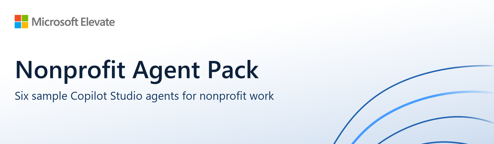
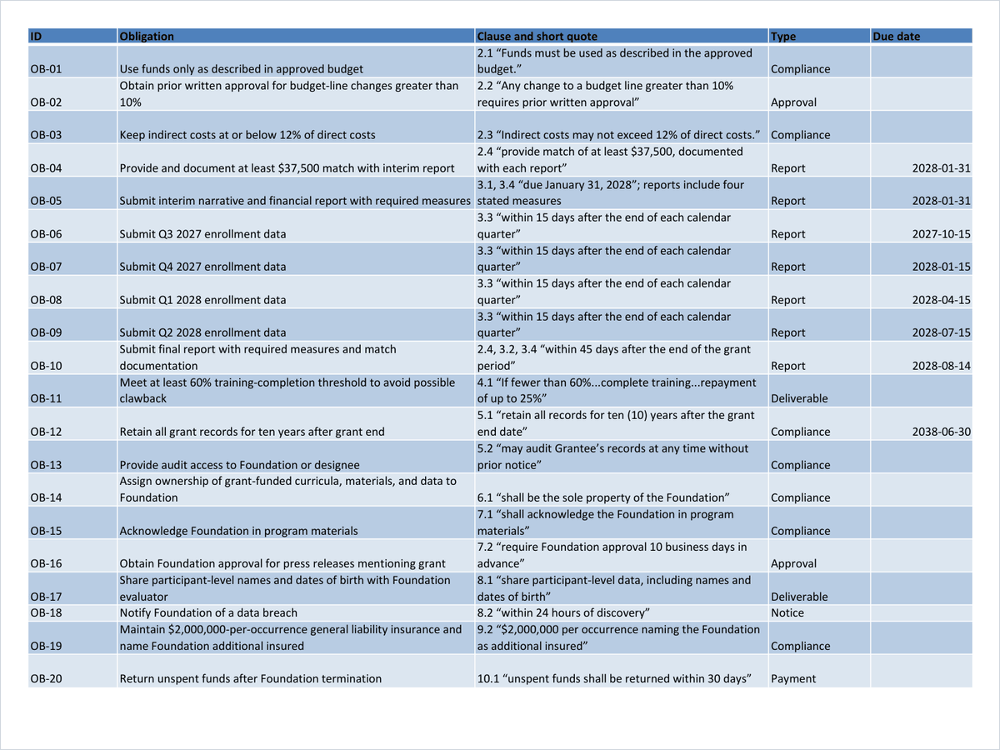
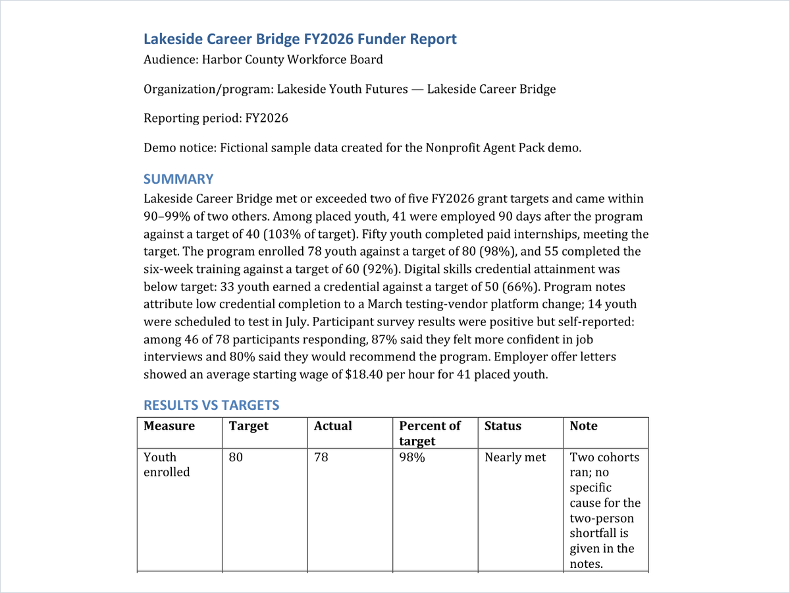
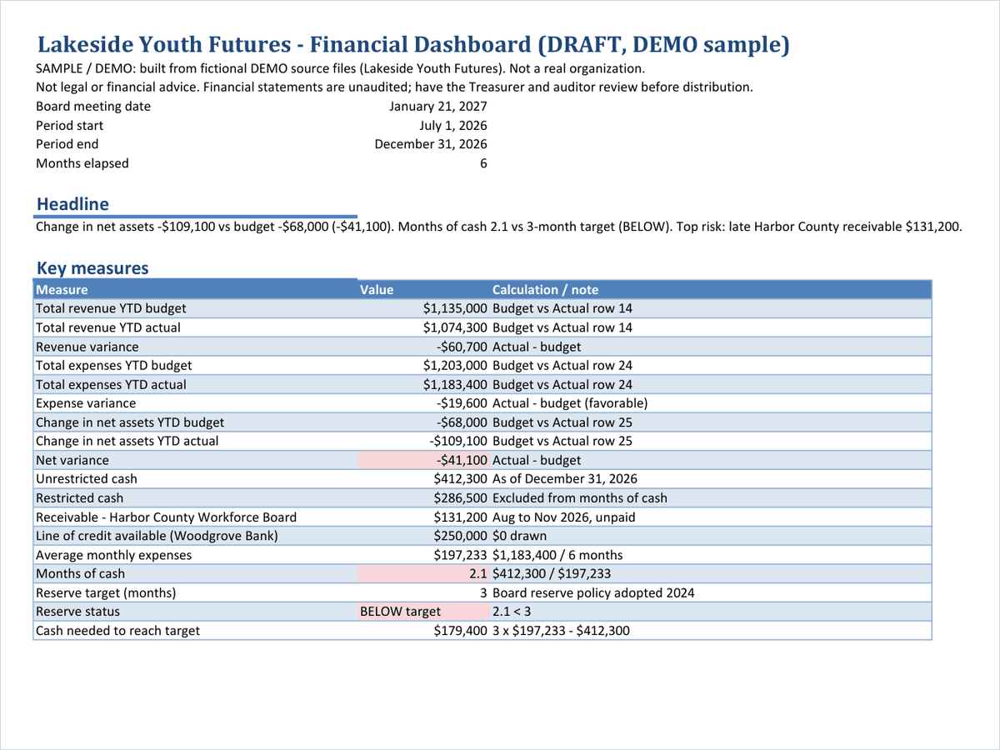

Agents for grant proposals, impact reports, agreement review, AI policy, IT help, and board packets. Each one works on your own documents and produces drafts for you to review. From Microsoft Elevate.

Built for US nonprofits, in English. Organizations in other countries can use the agents, but should adapt the playbooks to local laws and practices.

**Version 1.0.7** · Sample agents provided as-is under the [MIT License](LICENSE.txt) · Maintained on a best-effort basis ([support](SUPPORT.md))

## Example outputs

The agents made these files from the fictional sample data. Select an image to see it full size.

<table>
<tr>
<td width="33%" valign="top"> <b>Agreement Reviewer:</b> obligations register (Excel)</td>
<td width="33%" valign="top"> <b>Impact Report Builder:</b> funder report (Word)</td>
<td width="33%" valign="top"> <b>Board Packet Builder:</b> financial dashboard (Excel)</td>
</tr>
</table>

## Download

Get the files from the [latest release](https://github.com/microsoft/nonprofit-agent-pack/releases/latest), or from the links below.

|   | Download | What's inside |
|---|---|---|
|   | **[All six agents](downloads/NonprofitAgentPack_v1.0.7.zip)** | One `.zip` with every agent, a START HERE guide, and the license. Unzip this file once, then import agents from its **Agents** folder. |
|  | [Grant&nbsp;Proposal&nbsp;Studio](downloads/NonprofitAgentPack_GrantProposalStudio.zip) | This agent only. Import it as-is. |
|  | [Impact&nbsp;Report&nbsp;Builder](downloads/NonprofitAgentPack_ImpactReportBuilder.zip) | This agent only. Import it as-is. |
|  | [Agreement&nbsp;Reviewer](downloads/NonprofitAgentPack_AgreementReviewer.zip) | This agent only. Import it as-is. |
|  | [AI&nbsp;Policy&nbsp;Coach](downloads/NonprofitAgentPack_AIPolicyCoach.zip) | This agent only. Import it as-is. |
|  | [IT&nbsp;Help&nbsp;Desk](downloads/NonprofitAgentPack_ITHelpDesk.zip) | This agent only. Import it as-is. |
|  | [Board&nbsp;Packet&nbsp;Builder](downloads/NonprofitAgentPack_BoardPacketBuilder.zip) | This agent only (GitHub Copilot harness). Import it as-is. |

Never unzip an agent's own `.zip` file: Copilot Studio imports it as-is. If a link opens a file page instead of downloading, select **Download raw file** (the download icon).

<!-- customer-guide:start -->

## Start with one agent

New to Copilot Studio? Start with **Agreement Reviewer** or **Grant Proposal Studio**. They need the least setup, cost the least, and show the method best: run the sample first, then a real agreement or a funder's published RFP. If your organization hasn't decided how staff should use AI yet, start with **AI Policy Coach**, which needs no uploads.

## The agents

| Agent | Helps when | You upload | You get |
|---|---|---|---|
| **Grant Proposal Studio** | Proposals take too long | A funder's RFP or guidelines | Compliance matrix, outline mapped to the scoring criteria, drafted sections, rubric score with the top 3 fixes, funder research, Word and Excel files |
| **Impact Report Builder** | Funders want outcomes, not activities | Program notes, outcome data, or surveys | Results vs targets, an evidence register for every claim, the claims your data can't support, a Word report |
| **Agreement Reviewer** | You just got awarded | A grant agreement, contract, subaward, or MOU | Obligations with calculated due dates, risk flags, questions for the funder, an Excel workbook, an Outlook calendar file |
| **AI Policy Coach** | Staff are already using AI | Nothing, or your current policy | Answers about safe AI use, data rules, a two-page policy or a gap check, a governance plan, a 90-day rollout, a Word document |
| **IT Help Desk** | IT is one person, or no one | Nothing (add your IT procedures later) | Short numbered fixes, security triage, IT ticket summaries |
| **Board Packet Builder** (advanced) | Board prep takes a week | Financials, ED report, committee notes, prior minutes | A Word board packet, slide deck, and Excel dashboard with flagged variances, months of cash, consent agenda, and motions, all with matching numbers |

Every agent follows a written method (its playbook files), cites its sources, shows `[ADD: ...]` instead of inventing facts, and declines requests outside its job. Agents can still make mistakes, so review everything they produce.

## Before you start (for your admin)

| You need | Why | Learn more |
|---|---|---|
| A Power Platform environment with Dataverse. A sandbox is best for trying the agents. | Agents are imported as Power Platform solutions. | [Create an environment](https://learn.microsoft.com/power-platform/admin/create-environment) |
| The System Customizer or System Administrator role in that environment | It's required to import solutions. | [Import agents](https://learn.microsoft.com/microsoft-copilot-studio/authoring-solutions-import-export) |
| Copilot Studio access and Copilot credits | The agents use credits as described in "What it costs". | [Licensing](https://learn.microsoft.com/microsoft-copilot-studio/billing-licensing) |
| Code interpreter turned on for the environment. It's off by default; a Power Platform admin turns it on. | It creates the Word, Excel, and calendar files. | [Code interpreter](https://learn.microsoft.com/microsoft-copilot-studio/code-interpreter-for-prompts) |
| Board Packet Builder only: external models turned on for the environment, and Anthropic allowed as an AI provider in the Microsoft 365 admin center | It runs on an Anthropic Claude model on the GitHub Copilot harness. | [External model controls](https://learn.microsoft.com/microsoft-copilot-studio/agents-experience/authoring-select-agent-model), [Anthropic models](https://learn.microsoft.com/microsoft-365/copilot/connect-to-ai-subprocessor) |
| OneDrive for each person who uses the agents | Generated files open from Microsoft 365 storage. | |

No connectors, flows, environment variables, or custom tables are needed.

## What it costs

- Copilot Studio measures use in Copilot credits ([billing rates](https://learn.microsoft.com/microsoft-copilot-studio/requirements-messages-management)).
- Five agents run on the standard harness. Testing them in Copilot Studio's test chat doesn't use credits. When people with a Microsoft 365 Copilot license use them in Teams or Microsoft 365 Copilot, use is generally covered by that license; other use draws credits ([who pays](https://learn.microsoft.com/power-platform/admin/manage-usage-github-copilot-harness)).
- Board Packet Builder runs on the GitHub Copilot harness, which uses credits on every run, including tests, for every user ([GitHub Copilot harness billing](https://learn.microsoft.com/microsoft-copilot-studio/agents-experience/billing-credit-overview)). In October 2026 tests, the full sample packet used about 156 to 184 credits and took 5 to 17 minutes; single questions used about 8 to 55 credits. Credits for a chat can keep rising for a short time after it ends. Your results will vary.
- Set a credit limit for each agent and check usage in the Power Platform admin center. Limits can take some time to apply ([manage credits](https://learn.microsoft.com/power-platform/admin/manage-copilot-studio-copilot-credits-capacity)).

## Your data

- The agents run in your own Power Platform environment and Microsoft 365 tenant, under your organization's policies. The pack adds no connectors or flows. Board Packet Builder's Anthropic model and the Bing web search used by two agents are described below.
- The five standard agents use Copilot Studio's default model. Board Packet Builder uses an Anthropic Claude model. Anthropic models are currently excluded from the EU Data Boundary, and outside the United States they may process data outside your region ([Anthropic models](https://learn.microsoft.com/microsoft-365/copilot/connect-to-ai-subprocessor), [model regions](https://learn.microsoft.com/microsoft-copilot-studio/agents-experience/authoring-agent-model-availability)).
- Grant Proposal Studio searches the web for public facts about funders, and IT Help Desk looks up Microsoft Support and Microsoft Learn pages. Both send a short search query to Bing, not your files. Data sent to Bing is covered by the Microsoft Privacy Statement, not your organization's Data Protection Addendum, and may be processed outside your region. Admins can turn off web search in the Power Platform admin center ([web search data](https://learn.microsoft.com/microsoft-copilot-studio/data-privacy-security-web-search)).
- Board Packet Builder's memory is off. Memory is a preview feature that remembers each person's preferences between chats. A maker can turn it on with the **Memory** toggle on the agent's **Build** tab; memories are private to each person and are deleted after 28 days of inactivity ([memory](https://learn.microsoft.com/microsoft-copilot-studio/agents-experience/memory-overview)).
- Don't upload client case files, health information, information about minors, donor payment details, or anything marked Confidential unless your organization has approved this environment and agent for that data. No data policy yet? Start with AI Policy Coach.
- More detail: [Responsible AI notes](https://github.com/microsoft/nonprofit-agent-pack/blob/main/RESPONSIBLE_AI.md).

## Install (about 5 minutes per agent)

1. Go to [Copilot Studio](https://copilotstudio.microsoft.com) and check which environment you're in (select the environment name or globe icon to switch). Switch to your test environment if needed.
2. Select **More options** (**...**) in the left menu, then **Solutions**. Solutions opens in a new tab. If a welcome screen or message appears, close it or select **Get Started** or **Skip**.
3. Select **Import solution** > **Browse**, choose one agent's `.zip` (from the **Agents** folder of the full pack), then select **Next** > **Import**. A note that the solution came from a "Full" environment is expected.
4. Wait for "imported successfully" (usually under a minute). Open the agent from **Agents** and select **Publish**.
5. To use it in Teams and Microsoft 365 Copilot, open the agent, go to **Channels** > **Teams and Microsoft 365 Copilot**, and select **Add channel**. Then share it with a security group ([standard agents](https://learn.microsoft.com/microsoft-copilot-studio/admin-share-bots), [Board Packet Builder](https://learn.microsoft.com/microsoft-copilot-studio/agents-experience/authoring-share-agent)). To show it to everyone in your organization, your admin must approve it ([Teams and Microsoft 365 Copilot](https://learn.microsoft.com/microsoft-copilot-studio/publication-add-bot-to-microsoft-teams)).

A new agent may show "1 warning: No evaluation has been run". That's expected; see "Make it yours".

## Try it in 5 minutes

See a finished result before you use your own files. In Copilot Studio, select **Test** (Board Packet Builder: **Preview**) and paste a prompt below; in Teams, select **See a sample**. IT Help Desk needs no files.

| Agent | Try this | A good result |
|---|---|---|
| Grant Proposal Studio | "Using the sample RFP and program brief, build the compliance matrix, list eligibility risks, and outline the proposal against the scoring criteria. Then create the Word outline and Excel matrix." | Gaps such as a missing sustainability plan, audit timing, and the limit on in-kind match are found and flagged with `[ADD: ...]`, not invented. |
| Impact Report Builder | "Using the sample program notes, build a funder report for the Harbor County Workforce Board. Include the evidence register and the claims the data can't support. Then create the Word report." | Outcomes lead, every claim traces to the data, sample sizes are shown, and unsupported claims get safer wording. |
| Agreement Reviewer | "Review the sample grant agreement. List obligations with due dates, flag risks, and draft questions for the funder. Then create the Excel workbook and calendar file." | Each obligation cites its clause, and every due date shows its calculation. |
| AI Policy Coach | "Show me a sample policy and governance plan for a fictional nonprofit." | Clear allowed and prohibited uses, data rules, human review, incident reporting, and named owners. |
| IT Help Desk | "I got a new phone and my Authenticator app is on the old one, which I no longer have. What do I do?" | Safe numbered steps first, then an offer to create a ticket summary for IT. It never asks for a password or code. |
| Board Packet Builder | "Show me how you work using the sample board files." | 5 flagged variances, net year to date of -$109,100, and 2.1 months of cash, with the same numbers in all three files. Allow 5 to 20 minutes and about 160 to 185 credits. |

## Put it to work

| Agent | Upload | Then ask |
|---|---|---|
| Grant Proposal Studio | A funder's RFP or guidelines | "Build the compliance matrix and list our eligibility risks." Then "Outline the proposal," or upload a draft and ask "Score it and give me the 3 fixes worth the most points." |
| Impact Report Builder | Program notes, outcome data, or survey results | "Build a funder report for [funder] for [period]." Then "Which claims aren't supported?" and "Create the Word document." |
| Agreement Reviewer | A grant agreement, contract, subaward, or MOU | "Review this agreement." Then "Create the Excel workbook and calendar file." |
| AI Policy Coach | Nothing, or your current policy | "Can staff use public AI tools for donor letters?", "Help me create an AI acceptable use policy," or "What's missing from our policy?" |
| IT Help Desk | Nothing | Any Microsoft 365 question, such as "How do I move my Authenticator to a new phone?" |
| Board Packet Builder | This quarter's financials, ED report, committee notes, and last minutes | "Build our board packet." You get a Word packet, a slide deck, and an Excel dashboard, with the numbers matched across all three. |

Uploaded files are the primary source. Most answers take 1 to 3 minutes; long documents and Board Packet Builder take longer. Where something is missing, the agent shows `[ADD: ...]` instead of guessing.

## Make it yours

- **Add your documents** under **Knowledge** > **Add knowledge**: boilerplate, logic models, past reports, IT procedures, or a SharePoint site ([add files](https://learn.microsoft.com/microsoft-copilot-studio/knowledge-add-file-upload), [add SharePoint](https://learn.microsoft.com/microsoft-copilot-studio/knowledge-add-sharepoint)).
- **Swap the playbooks.** The knowledge files whose names start with a code (such as **GPS-01 Proposal Review Rubric**) define each agent's method. Replace one with your own version under the same name.
- **IT Help Desk:** replace the `[ADD: ...]` contact placeholder in the agent's instructions and in the **Escalate** topic with your help desk portal, email, or phone, and hours.
- **Before staff use an agent,** delete the **DEMO** knowledge files and the **See a sample** prompt, then select **Publish**.
- **Check your changes** with an evaluation. Board Packet Builder includes a 20-question test set ([evaluation.csv](https://github.com/microsoft/nonprofit-agent-pack/blob/main/samples/board-packet-builder/evaluation.csv)) you can import on its **Evaluate** tab. Running an evaluation uses credits.
- **Updating to a new version** replaces the agent's instructions, topics, and playbook files; knowledge you added stays. Keep a copy of anything you changed, such as IT contacts, and reapply it after you import. Then select **Publish**. See the [change log](https://github.com/microsoft/nonprofit-agent-pack/blob/main/CHANGELOG.md).

## Use it responsibly

Review every output before you submit, sign, or publish it. Get qualified review of agreements, policies, and financial content; the agents don't give legal, tax, or financial advice. The playbooks reflect common US practice as of October 2026; laws and practices elsewhere differ. Start with a small pilot and check credit usage in the Power Platform admin center. Learn more in [security and governance](https://learn.microsoft.com/microsoft-copilot-studio/security-and-governance).

## Troubleshooting

| Problem | Try this |
|---|---|
| Import fails right away | You may be importing the whole pack. Unzip it first, then import an agent's `.zip` from the **Agents** folder. Also confirm you have the System Customizer role and Dataverse, or try another environment if your admin blocks unmanaged solutions. |
| "Sorry, I couldn't finish that", or a "ContentFiltered" error | The file may contain hidden text or content your organization's safety settings block. Try another file, or paste the section you need. |
| The agent says it couldn't read my file | Try a PDF or a shorter excerpt. |
| A file link asks me to sign in | Generated files open from Microsoft 365. Sign in with your work account; you need OneDrive. |
| No Word, Excel, or calendar file | Ask again ("Create the file now"). If it still fails, ask your admin whether code interpreter is turned on for this environment. |
| Board Packet Builder won't run or shows a model error | Your admin needs to turn on external models and allow Anthropic (see "Before you start"). You can also select a different model on the agent's **Build** tab; we tested with Claude Opus 5.5, so results may differ. Some Anthropic models have different data terms, so check with your admin before you switch. |
| Teams install doesn't work | Your organization may block Power Platform apps in Teams ([Teams prerequisites](https://learn.microsoft.com/microsoft-copilot-studio/publication-add-bot-to-microsoft-teams#prerequisites)). |
| A newer version won't replace the old one | Import the new `.zip` over the existing agent; it updates in place. Then select **Publish**. |

## Terms

Sample agents provided as-is under the MIT License, without warranty or support commitments. They use generative AI and can make mistakes; review outputs before use.
<!-- customer-guide:end -->

## For builders

- **[skills](skills)** packages each agent's method as an [Agent Skill](https://learn.microsoft.com/microsoft-copilot-studio/agents-experience/skills-overview), plus `board-packet-standard` and `nonprofit-financial-dashboard`. Upload a skill's `.zip` to an agent on the GitHub Copilot harness, or read its `SKILL.md` to reuse the method elsewhere.
- **[samples/board-packet-builder](samples/board-packet-builder)** has the four fictional board files and `evaluation.csv`, a 20-case test set. Import it on Board Packet Builder's **Evaluate** tab to check the agent after you customize it.
- **[RESPONSIBLE_AI.md](RESPONSIBLE_AI.md)** describes intended uses, limitations, and data handling. **[CHANGELOG.md](CHANGELOG.md)** lists changes by version.

## Support and contributing

These are sample agents with best-effort support through GitHub Issues; Microsoft product support doesn't cover them. See [SUPPORT.md](SUPPORT.md). Report security issues as described in [SECURITY.md](SECURITY.md), not in public issues. To improve an agent or propose a new one, build on this pack rather than starting a separate one; see [CONTRIBUTING.md](CONTRIBUTING.md).

## Trademarks

This project may contain trademarks or logos for projects, products, or services. Authorized use of Microsoft trademarks or logos is subject to and must follow [Microsoft's Trademark & Brand Guidelines](https://www.microsoft.com/legal/intellectualproperty/trademarks/usage/general). Use of Microsoft trademarks or logos in modified versions of this project must not cause confusion or imply Microsoft sponsorship. Any use of third-party trademarks or logos is subject to those third parties' policies.

*This repository is intended as an example or learning tool.*
